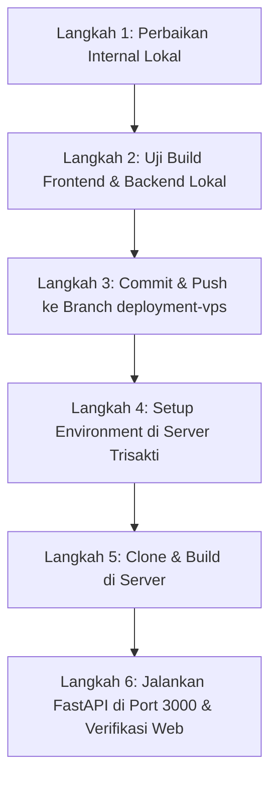

# Rencana & Analisis Deployment Graphelp (Server Lab Trisakti)

Dokumen ini berisi analisis menyeluruh terhadap arsitektur aplikasi **Graphelp** yang telah disesuaikan **100% dengan hasil audit nyata server Lab Trisakti**:
* **URL Publik:** `https://lab1.trisakti.ac.id/graphelp/`
* **Subpath Web:** `/graphelp/`
* **Host SSH:** `103.28.161.35:22007` (User: `graphelp`, Non-root)
* **Spesifikasi Server:** 8 Core Intel Xeon, 15 GB RAM, 460 GB Disk, Debian 12
* **Database MySQL:** `mysql-graphelp:3306` (Pre-configured)
* **Ingress Port:** Port **3000** (Otomatis diteruskan oleh reverse proxy Lab ke URL publik)

---

## 1. Analisis Lingkungan Nyata Server Lab Trisakti

Berdasarkan audit langsung via SSH pada server:
1. **Hak Akses User:** User adalah `graphelp` (non-root tanpa `sudo`). Kita **tidak menggunakan Docker** (Docker tidak terpasang dan tidak ada hak akses root).
2. **Runtime Siap Pakai:** Python 3.11.2 (`venv` & `pip`), Node.js v18.20.4, npm 9.2.0, dan Git sudah terpasang rapi.
3. **Kapasitas Hardware:** RAM 15 GB dan 8 Core CPU sangat mumpuni untuk inferensi PyTorch CPU (EfficientNet-B0) dan OpenCV.
4. **Alur Port 3000:** Reverse proxy luar Lab meneruskan `https://lab1.trisakti.ac.id/graphelp/` ke **port 3000** di dalam container. Saat ini port 3000 diisi default oleh `python3 -m http.server 3000`.

### Solusi Arsitektur Terbaik:
Kita akan menjalankan **FastAPI (Uvicorn) langsung di port 3000** (menggantikan http.server bawaan). FastAPI akan melayani:
1. **Endpoint API:** `/analyze-handwriting`, `/analyze-students`, `/login`, dll.
2. **File Unggahan:** `/uploads/...` (folder citra tulisan tangan).
3. **Frontend React SPA:** Menyajikan hasil build statis React (`frontend/dist`) langsung pada path `/graphelp/` dan root.

> **Keuntungan Arsitektur Ini:**
> * Tidak membutuhkan Nginx terpisah atau hak akses `sudo`.
> * Tidak ada masalah CORS (karena Frontend dan Backend dilayani di domain & port yang sama).
> * Hemat resource, cepat, dan 100% kompatibel dengan aturan container Lab Trisakti.

---

## 2. Penyesuaian Internal Lokal (Yang Harus Dibereskan di Lokal)

Sebelum melakukan apa pun di server, ada 5 penyesuaian internal yang wajib diselesaikan di komputer lokal pada branch `deployment-vps`:

### A. Penyesuaian Subpath `/graphelp/` di Frontend
Karena aplikasi berada di subpath `/graphelp/`:
1. **`frontend/vite.config.js`:**
   ```javascript
   export default defineConfig({
     plugins: [react()],
     base: '/graphelp/',
   })
   ```
2. **`frontend/src/App.jsx`:**
   ```jsx
   <BrowserRouter basename="/graphelp">
   ```

### B. Sentralisasi URL API Frontend
Saat ini terdapat 8 file frontend yang memanggil hardcoded `http://localhost:8000`. Karena Frontend dan Backend disatukan di port 3000, kita ubah pemanggilan API menjadi path relatif (misal `/graphelp/analyze-handwriting` atau via helper `API_BASE_URL`):
* `frontend/src/Auth/ForgotPasswordPage.jsx`
* `frontend/src/Auth/LoginPage.jsx`
* `frontend/src/Auth/RegisterPage.jsx`
* `frontend/src/Auth/ResetPasswordPage.jsx`
* `frontend/src/Auth/VerifyOtpPage.jsx`
* `frontend/src/pages/analyzepage.jsx`
* `frontend/src/pages/HistoryPage.jsx`
* `frontend/src/pages/StudentPage.jsx`

### C. Penyesuaian Schema Database di `backend/app/models.py` untuk MySQL
Pada database MySQL, kolom yang diberi indeks atau unique constraint wajib memiliki panjang karakter eksplisit:
* `username = Column(String(100), unique=True, index=True, nullable=False)`
* `email = Column(String(150), unique=True, index=True, nullable=False)`
* `password = Column(String(255), nullable=False)`
* `role = Column(String(50), default="public")`
* `school_name = Column(String(255), nullable=True)`
* `school_email = Column(String(150), nullable=True)`
* `bukti_path = Column(String(255), nullable=True)`
* `absence_number = Column(String(50), nullable=True)`
* `student_name = Column(String(255), nullable=False)`
* `age = Column(String(50), nullable=True)`
* `gender = Column(String(20), nullable=True)`
* `type_name = Column(String(100), nullable=True)`
* `image_path = Column(String(255), nullable=True)`

### D. Melengkapi `requirements.txt`
Menambahkan dependensi yang dibutuhkan oleh skrining motorik dan koneksi MySQL:
* `pymysql`
* `cryptography`
* `opencv-python-headless`
* `scikit-learn`
* `joblib`
* `pandas`
* `scipy`

### E. Integrasi Penyajian Frontend di `backend/app/main.py`
Menambahkan handler statis di FastAPI agar saat user mengakses `/graphelp/`, FastAPI otomatis mengirimkan file `frontend/dist/index.html` dan aset-aset CSS/JS dari folder `frontend/dist/assets`.

### F. Memperbarui `.gitignore`
Pastikan model `backend/ml_models/model_kesimpulan_motorik.joblib` diizinkan masuk ke Git (`!backend/ml_models/*.joblib`) agar ikut terbawa saat di-clone di server.

---

## 3. Rencana Kerja Bertahap (Roadmap)



### Rincian Eksekusi:
1. **Langkah 1 (Fokus Saat Ini):** Terapkan seluruh perbaikan kode internal di komputer lokal.
2. **Langkah 2:** Uji coba jalankan `npm run build` lokal untuk memastikan tidak ada syntax error.
3. **Langkah 3:** Lakukan `git add`, `git commit`, dan `git push` ke branch `deployment-vps`.
4. **Langkah 4 - 6:** Jalankan perintah deploy di server Trisakti Lab sesuai panduan di [COMMANDS.md](file:///c:/Users/faiz/Documents/tgstgs\Semester%207\Graphelp\COMMANDS.md).
