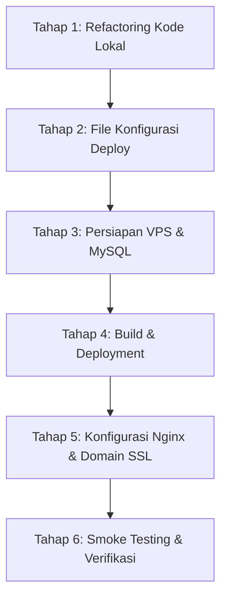

# Rencana & Analisis Deployment Graphelp ke VPS (Database MySQL)

Dokumen ini berisi analisis menyeluruh terhadap arsitektur aplikasi **Graphelp**, identifikasi masalah potensial sebelum deploy, adaptasi database ke **MySQL**, serta panduan langkah demi langkah (*step-by-step roadmap*) untuk melakukan deployment di Virtual Private Server (VPS).

---

## 1. Ringkasan Eksekutif & Status Sistem

Aplikasi **Graphelp** terdiri dari 3 komponen utama:
1. **Frontend:** React 19 + Vite + React Router 7.
2. **Backend:** FastAPI + Uvicorn + PyTorch CPU (EfficientNet-B0) + OpenCV + Scikit-Learn/Joblib.
3. **Database:** Dialihkan dari PostgreSQL/SQLite ke **MySQL**.

### Analisis Kebutuhan Resource VPS
* **Model AI (EfficientNet-B0 + OpenCV):** Model deep learning PyTorch dimuat langsung ke memori saat backend aktif. Diperlukan memori minimal ~600MB - 1GB hanya untuk runtime PyTorch & model weights.
* **Rekomendasi Spesifikasi Server:**
  * **RAM:** Minimal **2 GB** (Wajib dikonfigurasi **Swap Space 2 - 4 GB**). Disarankan **4 GB RAM** jika database MySQL berjalan di server yang sama.
  * **CPU:** 1 - 2 vCPU.
  * **Storage:** Minimal 20 - 25 GB SSD (untuk OS, Docker image / dependencies Python PyTorch, model `.pth`, dan folder penyimpanan gambar tulisan tangan).
  * **OS:** Ubuntu 22.04 LTS atau Ubuntu 24.04 LTS.

---

## 2. Analisis & Penyesuaian Database MySQL

Sebelumnya, konfigurasi default proyek mengarah ke PostgreSQL. Penggunaan **MySQL** memerlukan beberapa penyesuaian wajib di sisi kode dan konfigurasi:

### A. Driver Python untuk MySQL
Di Python / SQLAlchemy, driver MySQL yang paling stabil dan mudah dipasang di lingkungan Linux tanpa kompilasi C adalah `pymysql` dan modul `cryptography` (wajib untuk autentikasi MySQL 8+ `caching_sha2_password`).
* **Format `DATABASE_URL`:**
  ```env
  DATABASE_URL=mysql+pymysql://<user>:<password>@<host>:<port>/<nama_database>?charset=utf8mb4
  ```

### B. Masalah Kritis Definisi Schema di `models.py`
Pada file `backend/app/models.py`, beberapa kolom didefinisikan dengan tipe `String` tanpa parameter panjang, contohnya:
```python
username = Column(String, unique=True, index=True, nullable=False)
email = Column(String, unique=True, index=True, nullable=False)
```
* **Masalah pada MySQL:** Berbeda dengan PostgreSQL/SQLite yang membolehkan tipe `VARCHAR` tanpa limit panjang, MySQL **mewajibkan** batasan panjang pada kolom `VARCHAR` yang memiliki indeks atau *unique constraint*. Tanpa batasan panjang, MySQL akan memunculkan error:
  `1170: BLOB/TEXT column 'username' used in key specification without a key length`.
* **Solusi Wajib:** Update seluruh kolom `String` di `models.py` menjadi panjang eksplisit, misalnya:
  * `username = Column(String(100), unique=True, index=True, nullable=False)`
  * `email = Column(String(150), unique=True, index=True, nullable=False)`
  * `password = Column(String(255), nullable=False)`
  * `role = Column(String(50), default="public")`
  * `school_name = Column(String(255), nullable=True)`
  * `school_email = Column(String(150), nullable=True)`
  * `bukti_path = Column(String(255), nullable=True)`
  * `absence_number = Column(String(50), nullable=True)`
  * `student_name = Column(String(255), nullable=False)`
  * `age = Column(String(50), nullable=True)`
  * `gender = Column(String(20), nullable=True)`
  * `type_name = Column(String(100), nullable=True)`
  * `image_path = Column(String(255), nullable=True)`

### C. Charset & Collation Database MySQL
Pastikan database MySQL dibuat menggunakan charset `utf8mb4` agar kompatibel penuh dengan berbagai karakter teks dan emoji:
```sql
CREATE DATABASE graphelp_db CHARACTER SET utf8mb4 COLLATE utf8mb4_unicode_ci;
```

---

## 3. Analisis Frontend & Komunikasi API

### Masalah Hardcoded `http://localhost:8000`
Saat ini terdapat 8 file di frontend yang melakukan panggilan API langsung ke `localhost:8000`:
* `frontend/src/Auth/ForgotPasswordPage.jsx`
* `frontend/src/Auth/LoginPage.jsx`
* `frontend/src/Auth/RegisterPage.jsx`
* `frontend/src/Auth/ResetPasswordPage.jsx`
* `frontend/src/Auth/VerifyOtpPage.jsx`
* `frontend/src/pages/analyzepage.jsx`
* `frontend/src/pages/HistoryPage.jsx`
* `frontend/src/pages/StudentPage.jsx`

**Dampaknya jika di-deploy ke VPS:**
Ketika pengguna membuka website dari laptop/HP mereka, browser pengguna akan mencoba menghubungi `http://localhost:8000` di perangkat mereka sendiri, bukan server VPS. Akibatnya seluruh login, registrasi, dan upload akan gagal total (*Connection Refused*).

**Solusi:**
1. Buat helper konfigurasi terpusat: `frontend/src/config/api.js`.
2. Gunakan `import.meta.env.VITE_API_URL` dengan fallback ke relative path atau IP/domain server.
3. Di level Nginx pada VPS, kita bisa mengatur reverse proxy:
   * Request ke `/` diarahkan ke static build React.
   * Request ke `/api/` atau endpoint backend diteruskan internal ke `http://127.0.0.1:8000`.

---

## 4. Analisis Machine Learning & Dependensi Backend

### A. Dependensi Hilang di `requirements.txt`
File `requirements.txt` saat ini belum mencakup modul yang digunakan oleh fitur skrining motorik (`predict_motorik.py`):
* `opencv-python-headless` (Wajib headless di server Linux agar tidak memerlukan paket GUI X11).
* `joblib`
* `scikit-learn`
* `pandas`
* `scipy`
* `pymysql` (driver MySQL)
* `cryptography` (driver auth MySQL)

### B. Optimasi PyTorch CPU di Linux Server
Di Linux, menginstal PyTorch standar tanpa opsi CPU akan mengunduh bundle CUDA Nvidia sebesar >2.5 GB, yang bisa memenuhi disk VPS kecil dan memakan waktu lama. Kita harus memastikan instalasi PyTorch menggunakan wheel CPU:
```bash
pip install torch torchvision --index-url https://download.pytorch.org/whl/cpu
```

### C. Model Machine Learning di `.gitignore`
* File `.gitignore` baris 35 memiliki aturan `*.joblib`.
* Akibatnya, `backend/ml_models/model_kesimpulan_motorik.joblib` **tidak masuk ke repository Git**.
* Jika repo di-clone di VPS, backend akan crash dengan `FileNotFoundError` saat endpoint `/analyze-students` dipanggil.
* **Solusi:** Ubah `.gitignore` agar mengecualikan file model produksi:
  ```gitignore
  *.joblib
  !backend/ml_models/*.joblib
  ```
  Lalu lakukan git commit untuk file model tersebut.

### D. Direktori Uploads Persisten
Endpoint upload menyimpan gambar ke `backend/uploads/handwriting/`. Di VPS, direktori ini harus dibuat secara otomatis dan memiliki permission tulis (write access) bagi user yang menjalankan backend.

---

## 5. Pilihan Strategi Deployment

Terdapat dua pendekatan utama untuk deployment di VPS:

| Aspek | Opsi A: Docker & Docker Compose (Direkomendasikan) | Opsi B: Bare-Metal (Systemd + Nginx) |
| --- | --- | --- |
| **Kemudahan Setup** | Sangat mudah, sekali jalan via script | Memerlukan instalasi manual Python, Node, MySQL, Nginx di OS |
| **Isolasi Lingkungan** | Tinggi (versi Python 3.11/3.13 dan library terisolasi di container) | Berbagi environment dengan OS host |
| **Portabilitas & Backup** | Mudah dipindah ke server lain kapan saja | Bergantung pada konfigurasi OS host |
| **Konsumsi RAM** | Tambahan overhead Docker minimal (~50-100MB) | Sedikit lebih hemat memori |
| **Rekomendasi** | **Sangat Direkomendasikan** untuk konsistensi PyTorch & OpenCV | Cocok jika VPS RAM sangat terbatas (1 GB) |

---

## 6. Rencana Kerja Bertahap (Action Plan & Roadmap)



### Tahap 1: Refactoring Kode & Dependensi Lokal (Sebelum Push ke Git)
- [ ] **1.1 Sesuaikan `backend/app/models.py`:** Berikan batasan panjang pada seluruh tipe `String` (`String(100)`, `String(255)`, dll.) agar kompatibel dengan MySQL.
- [ ] **1.2 Update `requirements.txt`:** Tambahkan `pymysql`, `cryptography`, `opencv-python-headless`, `scikit-learn`, `joblib`, `pandas`, `scipy`.
- [ ] **1.3 Perbaiki `.gitignore`:** Izinkan commit untuk `!backend/ml_models/*.joblib` dan pastikan file model terlacak di Git.
- [ ] **1.4 Sentralisasi URL API di Frontend:** Buat `frontend/src/config/api.js` dan ganti seluruh pemanggilan `http://localhost:8000` menggunakan base URL dinamis.

### Tahap 2: Persiapan Konfigurasi Deployment
- [ ] **2.1 Buat `backend/Dockerfile`:**
  * Base image: `python:3.11-slim` atau `python:3.12-slim`.
  * Install dependensi sistem minimal (`libglib2.0-0`, `curl`).
  * Install PyTorch CPU via official wheel index.
  * Install `requirements.txt`.
  * Expose port 8000.
- [ ] **2.2 Buat `frontend/Dockerfile` & Nginx Conf:**
  * Multi-stage build: Stage 1 build React via Node.js, Stage 2 serve hasil build dengan Nginx alpine.
- [ ] **2.3 Buat `docker-compose.yml`:**
  * Service `backend` (FastAPI) dengan volume mount untuk `uploads/`.
  * Service `frontend` (Nginx).
  * Service `mysql` (Opsional, jika MySQL dijalankan di dalam Docker) atau koneksi ke instance MySQL VPS.
- [ ] **2.4 Siapkan Template `.env.production`:**
  * Format `DATABASE_URL` MySQL, `SMTP_EMAIL`, `SMTP_PASSWORD`.

### Tahap 3: Setup Server VPS & MySQL
- [ ] **3.1 Buat Swap Memory di VPS (Sangat Penting):**
  ```bash
  sudo fallocate -l 3G /swapfile
  sudo chmod 600 /swapfile
  sudo mkswap /swapfile
  sudo swapon /swapfile
  echo '/swapfile none swap sw 0 0' | sudo tee -a /etc/fstab
  ```
- [ ] **3.2 Setup MySQL Server di VPS:**
  * Buat user dan database baru:
    ```sql
    CREATE DATABASE graphelp_db CHARACTER SET utf8mb4 COLLATE utf8mb4_unicode_ci;
    CREATE USER 'graphelp_user'@'%' IDENTIFIED BY 'PasswordKuatAnda123!';
    GRANT ALL PRIVILEGES ON graphelp_db.* TO 'graphelp_user'@'%';
    FLUSH PRIVILEGES;
    ```
- [ ] **3.3 Install Docker & Docker Compose (Jika Opsi Docker):**
  ```bash
  curl -fsSL https://get.docker.com -o get-docker.sh && sh get-docker.sh
  sudo usermod -aG docker $USER
  ```

### Tahap 4: Build & Deployment di VPS
- [ ] **4.1 Clone Repository ke VPS:**
  ```bash
  git clone https://github.com/Noaaaaaw/Graphelp.git /opt/graphelp
  cd /opt/graphelp
  ```
- [ ] **4.2 Konfigurasi `.env` Produksi di VPS:**
  Isi `DATABASE_URL` mengarah ke database MySQL yang sudah dibuat.
- [ ] **4.3 Jalankan Build & Up:**
  ```bash
  docker compose up -d --build
  ```

### Tahap 5: Domain & SSL HTTPS
- [ ] **5.1 Setup DNS Domain / Subdomain:** Arahkan A-Record domain ke IP Publik VPS.
- [ ] **5.2 Setup Nginx & Certbot (Let's Encrypt):**
  Pasang sertifikat SSL gratis agar komunikasi form login, password, dan foto tulisan tangan terenkripsi (HTTPS).

### Tahap 6: Pengujian Sistem (Smoke Testing)
- [ ] Uji koneksi database: pastikan tabel `users`, `analysis_sessions`, dan `student_analysis_results` terbentuk otomatis.
- [ ] Uji pengiriman OTP registrasi ke email (koneksi SMTP Gmail port 465).
- [ ] Uji registrasi dan login akun.
- [ ] Uji analisis Enneagram (Single analyze) & cek penyimpanan file gambar di folder uploads.
- [ ] Uji analisis motorik siswa (Multiple analyze untuk akun guru).
- [ ] Uji halaman riwayat (History).

---

## 7. Catatan Keamanan & Praktik Terbaik

1. **Rahasiakan Kredensial:** Jangan pernah melakukan push file `.env` yang berisi password MySQL dan password aplikasi Gmail ke GitHub publik.
2. **Firewall VPS (UFW):**
   * Buka hanya port yang diperlukan:
     ```bash
     sudo ufw allow OpenSSH
     sudo ufw allow 80/tcp
     sudo ufw allow 443/tcp
     sudo ufw enable
     ```
   * Jika MySQL berjalan di server yang sama dengan backend, jangan buka port 3306 ke publik internet. Biarkan hanya diakses secara lokal (`localhost` atau jaringan Docker internal).
3. **Penyimpanan Upload Gambar:** Lakukan backup berkala pada direktori `backend/uploads/` dan database MySQL menggunakan cron job.

---

*Dokumen ini dapat diperbarui seiring berjalannya proses persiapan dan deployment.*
