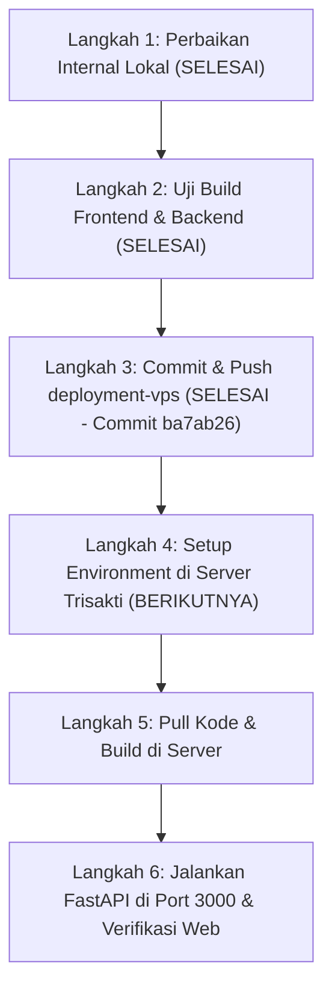

# Rencana & Analisis Deployment Graphelp (Server Lab Trisakti)

Dokumen ini berisi analisis menyeluruh terhadap arsitektur aplikasi **Graphelp** yang telah disesuaikan **100% dengan hasil audit nyata server Lab Trisakti**:
* **URL Publik:** `https://lab1.trisakti.ac.id/graphelp/`
* **Subpath Web:** `/graphelp/`
* **Host SSH:** `103.28.161.35:22007` (User: `graphelp`, Non-root)
* **Spesifikasi Server:** 8 Core Intel Xeon, 15 GB RAM, 460 GB Disk, Debian 12
* **Database MySQL:** `mysql-graphelp:3306` (Pre-configured)
* **Ingress Port:** Port **3000** (Otomatis diteruskan oleh reverse proxy Lab ke URL publik)

---

## 1. Analisis Lingkungan Nyata Server Lab Trisakti

Berdasarkan audit langsung via SSH pada server:
1. **Hak Akses User:** User adalah `graphelp` (non-root tanpa `sudo`). Kita **tidak menggunakan Docker** (Docker tidak terpasang dan tidak ada hak akses root).
2. **Runtime Siap Pakai:** Python 3.11.2 (`venv` & `pip`), Node.js v18.20.4, npm 9.2.0, dan Git sudah terpasang rapi.
3. **Kapasitas Hardware:** RAM 15 GB dan 8 Core CPU sangat mumpuni untuk inferensi PyTorch CPU (EfficientNet-B0) dan OpenCV.
4. **Alur Port 3000:** Reverse proxy luar Lab meneruskan `https://lab1.trisakti.ac.id/graphelp/` ke **port 3000** di dalam container. Saat ini port 3000 diisi default oleh `python3 -m http.server 3000`.

### Solusi Arsitektur:
Kita menjalankan **FastAPI (Uvicorn) langsung di port 3000** (menggantikan http.server bawaan). FastAPI melayani:
1. **Endpoint API:** `/analyze-handwriting`, `/analyze-students`, `/login`, dll. (serta alias `/graphelp/...`).
2. **File Unggahan:** `/uploads/...` dan `/graphelp/uploads/...`.
3. **Frontend React SPA:** Menyajikan hasil build statis React (`frontend/dist`) langsung pada path `/graphelp/` dan root.

> **Keuntungan Arsitektur Ini:**
> * Tidak membutuhkan Nginx terpisah atau hak akses `sudo`.
> * Bebas masalah CORS (Frontend dan Backend berada di domain & port yang sama).
> * Hemat resource, cepat, dan 100% kompatibel dengan aturan container Lab Trisakti.

---

## 2. Status Penyesuaian Internal Lokal (SUDAH SELESAI)

Seluruh penyesuaian internal lokal telah berhasil diterapkan dan diuji coba:
* [x] **A. Subpath `/graphelp/` Frontend:** `base: '/graphelp/'` di `vite.config.js` dan `basename` dinamis di `App.jsx`.
* [x] **B. Sentralisasi URL API:** `frontend/src/config/api.js` dibuat, 8 file fetch hardcoded diperbarui.
* [x] **C. Schema Database MySQL:** Panjang kolom `String` di `backend/app/models.py` disesuaikan untuk MySQL.
* [x] **D. Kelengkapan Dependensi:** `requirements.txt` diperbarui dengan `pymysql`, `cryptography`, `opencv-python-headless`, `scikit-learn`, `joblib`, `pandas`, `scipy`.
* [x] **E. Penyajian Frontend di FastAPI:** `backend/app/main.py` diperbarui dengan static serving & SPA fallback.
* [x] **F. Whitelist Model:** `.gitignore` diperbarui untuk mengizinkan `!backend/ml_models/*.joblib`.
* [x] **G. Git Push:** Seluruh penyesuaian telah di-push ke remote branch **`origin/deployment-vps`** (Commit: `ba7ab26`).

---

## 3. Rencana Kerja Bertahap (Roadmap)

### Rincian Eksekusi Selanjutnya (Fase Deploy Server):
1. **Langkah 4:** Setup file `/home/graphelp/project/.env` dengan koneksi `mysql-graphelp`.
2. **Langkah 5:** Pull branch `deployment-vps` ke `/home/graphelp/project`, setup `.venv`, install PyTorch CPU wheel & requirements, dan build frontend.
3. **Langkah 6:** Matikan proses http.server lama di port 3000, jalankan FastAPI via nohup uvicorn, lalu verifikasi website di `https://lab1.trisakti.ac.id/graphelp/`.
