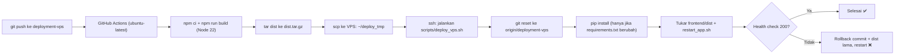

# AUTO_VPS — Rencana Auto-Deploy GitHub Actions ke Server Lab Trisakti

> **Untuk agent:** Dokumen ini adalah instruksi eksekusi. Kerjakan fase demi fase **secara berurutan**, jalankan langkah verifikasi di setiap fase, dan **berhenti lalu lapor ke user** kalau ada verifikasi yang gagal. Jangan improvisasi di luar rencana tanpa izin user.

---

## 0. Tujuan & Hasil Akhir

**Tujuan:** Setiap `git push` ke branch `deployment-vps` otomatis memperbarui website di `https://lab1.trisakti.ac.id/graphelp/` **tanpa ada yang perlu login SSH ke VPS.**

**Definisi selesai:**
- [ ] Push ke `deployment-vps` memicu workflow GitHub Actions "Auto Deploy VPS Trisakti".
- [ ] Workflow mem-build frontend (Node 22), meng-upload `dist`, menjalankan `git pull` + restart di VPS.
- [ ] Health check di VPS (`127.0.0.1:3000/graphelp/`) mengembalikan HTTP 200 setelah deploy.
- [ ] Kalau health check gagal, VPS **otomatis rollback** ke commit & build sebelumnya.
- [ ] Tidak ada password VPS yang disimpan di GitHub (pakai SSH key khusus deploy).
- [ ] `COMMANDS.md` & `DEPLOYMENT_PLAN.md` diperbarui dengan alur baru.

### Alur



---

## 1. Aturan Wajib (JANGAN DILANGGAR)

1. **Jangan pernah push / merge ke `main`.** Semua pekerjaan hanya di branch `deployment-vps`.
2. **Minta izin user secara eksplisit sebelum `git commit` dan `git push`.** Tunjukkan dulu daftar file yang akan di-commit. (User pernah menolak commit yang tidak diminta.)
3. **Jangan commit file rahasia/privat:** `datavps.md`, `.env`, `ANALISIS_*.md`, private key SSH, atau file apa pun yang berisi password.
4. **Jangan tulis password/kunci ke dokumen yang ter-track git.** Kredensial VPS ada di `datavps.md` (lokal, di-ignore).
5. **Di VPS jangan pernah jalankan `git clean`** — file `/home/graphelp/project/.env` berstatus untracked dan akan terhapus. `git reset --hard` aman (tidak menyentuh file untracked).
6. **Jangan mengubah kode aplikasi** (`backend/app/*`, `frontend/src/*`). Rencana ini hanya menambah file CI/CD dan merapikan skrip server.
7. Private key yang dibuat di laptop **wajib dihapus** setelah disimpan ke GitHub Secrets.

---

## 2. Kondisi Saat Ini (hasil pre-flight 13 Okt 2026)

| Item | Kondisi | Dampak ke rencana |
| :--- | :--- | :--- |
| SSH VPS | `103.28.161.35:22007`, user `graphelp`, non-root, tanpa sudo | Semua langkah tanpa sudo |
| Auth SSH | `PasswordAuthentication yes`, pubkey default aktif | Bisa pakai SSH key |
| `~/.ssh` di VPS | **Belum ada** | Harus dibuat (Fase 1) |
| Tool di VPS | `scp`, `tar`, `curl`, `git`, `setsid` ✅ — `rsync` ❌ | Upload pakai `scp` + `tar`, bukan rsync |
| Node.js di VPS | v18 (Vite 8 butuh Node ≥20) | **Build wajib di GitHub runner**, bukan di VPS |
| Repo VPS | `/home/graphelp/project`, bersih, hanya `?? .env` | `git reset --hard` aman |
| Remote VPS | `https://github.com/Noaaaaaw/Graphelp.git` (pull tanpa kredensial) | VPS bisa fetch langsung dari GitHub |
| `frontend/dist` | Tidak di-track git (`dist/` di `.gitignore`) | `dist` harus di-upload terpisah |
| `frontend/package-lock.json` | Ada | Pakai `npm ci` |
| Skrip server | `start_app.sh`, `stop_app.sh`, `restart_app.sh`, `status_app.sh` di `/home/graphelp/` | Dipakai ulang oleh deploy script |
| Folder `.github/` | Belum ada | Dibuat di Fase 4 |
| `gh` CLI lokal | v2.101.0 terpasang | Dipakai untuk set secrets & pantau run |
| `.gitignore` lokal | Ada perubahan belum di-commit (tambahan `ANALISIS_*.md`) | Tanyakan user apakah ikut di-commit |

**Cara akses VPS dari laptop (Windows):** pakai Python venv proyek + paramiko:
`.\.venv\Scripts\python.exe <script>.py` — simpan skrip sementara di folder scratch agent, bukan di repo.

---

## Fase 0 — Pre-flight Check

**Langkah:**
1. Pastikan branch lokal benar dan sinkron:
   ```powershell
   git checkout deployment-vps
   git pull origin deployment-vps
   git status
   ```
2. Cek login `gh` dan hak akses ke repo (butuh akses **admin/maintain** untuk set Secrets):
   ```powershell
   gh auth status
   gh api repos/Noaaaaaw/Graphelp --jq ".permissions"
   ```
3. Cek VPS masih sehat:
   ```bash
   /home/graphelp/status_app.sh
   curl -s -o /dev/null -w "%{http_code}\n" http://127.0.0.1:3000/graphelp/
   ```

**Verifikasi:**
- `permissions.admin` = `true` (atau minimal `maintain`). **Jika `false` → STOP.** Lapor ke user: pemilik repo (`Noaaaaaw`) harus memberi akses admin atau memasukkan Secrets sendiri (berikan daftar Secrets dari Fase 2).
- Health check VPS = `200`.

---

## Fase 1 — Siapkan SSH Key Khusus Deploy

Tujuan: GitHub Actions login ke VPS pakai key, **bukan password**.

**Langkah:**
1. Buat key ed25519 tanpa passphrase di folder scratch agent (BUKAN di repo):
   ```powershell
   ssh-keygen -t ed25519 -C "github-actions-graphelp" -N '""' -f "<SCRATCH>\gh_deploy_key"
   ```
   Hasil: `gh_deploy_key` (private) dan `gh_deploy_key.pub` (public).
2. Pasang public key ke VPS (login pakai password via paramiko, kredensial dari `datavps.md`). Perintah yang dijalankan di VPS:
   ```bash
   mkdir -p ~/.ssh && chmod 700 ~/.ssh
   touch ~/.ssh/authorized_keys && chmod 600 ~/.ssh/authorized_keys
   grep -qF "<ISI_PUBKEY>" ~/.ssh/authorized_keys || echo "<ISI_PUBKEY>" >> ~/.ssh/authorized_keys
   ```
   (Ganti `<ISI_PUBKEY>` dengan isi satu baris `gh_deploy_key.pub`.)
3. Ambil host key VPS untuk `known_hosts` (mencegah serangan MITM):
   ```powershell
   ssh-keyscan -p 22007 -t ed25519,rsa,ecdsa 103.28.161.35 > "<SCRATCH>\vps_known_hosts"
   ```
4. Tes login pakai key (harus tanpa prompt password):
   ```powershell
   ssh -i "<SCRATCH>\gh_deploy_key" -o IdentitiesOnly=yes -o UserKnownHostsFile="<SCRATCH>\vps_known_hosts" -p 22007 graphelp@103.28.161.35 "echo KEY_OK"
   ```

**Verifikasi:** Output `KEY_OK` tanpa diminta password.
**Jika gagal:** cek permission `~/.ssh` (700) & `authorized_keys` (600), cek pubkey satu baris utuh. Jangan lanjut sebelum `KEY_OK`.

---

## Fase 2 — Simpan GitHub Secrets

**Secrets yang dibuat** (repo `Noaaaaaw/Graphelp`):

| Nama Secret | Isi |
| :--- | :--- |
| `VPS_HOST` | `103.28.161.35` |
| `VPS_PORT` | `22007` |
| `VPS_USER` | `graphelp` |
| `VPS_SSH_KEY` | isi lengkap file `gh_deploy_key` (private key, termasuk baris BEGIN/END) |
| `VPS_KNOWN_HOSTS` | isi file `vps_known_hosts` |

**Langkah:**
```powershell
gh secret set VPS_HOST --repo Noaaaaaw/Graphelp --body "103.28.161.35"
gh secret set VPS_PORT --repo Noaaaaaw/Graphelp --body "22007"
gh secret set VPS_USER --repo Noaaaaaw/Graphelp --body "graphelp"
Get-Content "<SCRATCH>\gh_deploy_key" -Raw | gh secret set VPS_SSH_KEY --repo Noaaaaaw/Graphelp
Get-Content "<SCRATCH>\vps_known_hosts" -Raw | gh secret set VPS_KNOWN_HOSTS --repo Noaaaaaw/Graphelp
```

**Verifikasi:**
```powershell
gh secret list --repo Noaaaaaw/Graphelp
```
Kelima nama secret harus muncul.

**Setelah terverifikasi:** hapus private key lokal:
```powershell
Remove-Item "<SCRATCH>\gh_deploy_key"
```
(Public key & known_hosts boleh dihapus juga.) **Jangan pernah menyimpan `VPS_PASSWORD` di GitHub.**

---

## Fase 3 — Rapikan Skrip Start di VPS

Masalah: `start_app.sh` sekarang menjalankan uvicorn dengan `nohup ... &` tapi stdin tidak dilepas. Lewat SSH non-interaktif (GitHub Actions) ini bisa membuat sesi SSH **menggantung** atau prosesnya ikut mati saat sesi ditutup.

**Langkah:** Tulis ulang `/home/graphelp/start_app.sh` di VPS menjadi:
```bash
#!/bin/bash
PID=$(pgrep -f "uvicorn backend.app.main:app")
if [ -n "$PID" ]; then
    echo "Graphelp is already running (PID: $PID)."
    exit 0
fi
echo "Starting Graphelp backend on port 3000..."
cd /home/graphelp/project
setsid nohup .venv/bin/uvicorn backend.app.main:app --host 0.0.0.0 --port 3000 \
    >> /home/graphelp/backend.log 2>&1 < /dev/null &
sleep 3
PID=$(pgrep -f "uvicorn backend.app.main:app")
if [ -n "$PID" ]; then
    echo "Graphelp started successfully (PID: $PID)."
else
    echo "Failed to start Graphelp. Check /home/graphelp/backend.log"
    exit 1
fi
```
Pastikan `chmod 755`. Skrip `stop_app.sh`, `restart_app.sh`, `status_app.sh` tidak perlu diubah.

**Verifikasi:**
1. Jalankan via SSH key (dari laptop): `ssh ... "/home/graphelp/restart_app.sh"` → perintah **kembali ke prompt** (tidak menggantung) dan mencetak PID baru.
2. Setelah sesi SSH ditutup, cek ulang `status_app.sh` → masih RUNNING, dan `curl 127.0.0.1:3000/graphelp/` = 200.

---

## Fase 4 — Tambah File CI/CD ke Repo

Buat **dua file baru** (hanya ini; jangan ubah file lain kecuali dokumen di Fase 7).

### 4.1 `scripts/deploy_vps.sh`

Skrip ini dijalankan **di VPS** oleh workflow. Disimpan di repo agar terversi.

```bash
#!/usr/bin/env bash
# Deploy Graphelp di VPS Trisakti. Dipanggil oleh GitHub Actions
# setelah dist.tar.gz di-upload ke /home/graphelp/deploy_tmp/.
set -euo pipefail

PROJECT=/home/graphelp/project
TMP=/home/graphelp/deploy_tmp
BRANCH=deployment-vps
HEALTH_URL=http://127.0.0.1:3000/graphelp/

cd "$PROJECT"
PREV=$(git rev-parse HEAD)
echo "[deploy] commit sebelum : $PREV"

git fetch --quiet origin "$BRANCH"
git reset --hard "origin/$BRANCH"      # aman: .env (untracked) tidak tersentuh
NEW=$(git rev-parse HEAD)
echo "[deploy] commit sekarang: $NEW"

if ! git diff --quiet "$PREV" "$NEW" -- requirements.txt; then
    echo "[deploy] requirements.txt berubah -> pip install"
    .venv/bin/pip install -r requirements.txt
fi

# Tukar build frontend (simpan yang lama untuk rollback)
rm -rf frontend/dist.new frontend/dist.prev
mkdir -p frontend/dist.new
tar -xzf "$TMP/dist.tar.gz" -C frontend/dist.new --strip-components=1
if [ -d frontend/dist ]; then mv frontend/dist frontend/dist.prev; fi
mv frontend/dist.new frontend/dist

mkdir -p backend/uploads/handwriting

/home/graphelp/restart_app.sh

for i in $(seq 1 30); do
    CODE=$(curl -s -o /dev/null -w '%{http_code}' "$HEALTH_URL" || true)
    if [ "$CODE" = "200" ]; then
        echo "[deploy] health check OK (percobaan $i)"
        rm -f "$TMP/dist.tar.gz"
        exit 0
    fi
    sleep 2
done

echo "[deploy] health check GAGAL -> rollback ke $PREV"
git reset --hard "$PREV"
if [ -d frontend/dist.prev ]; then
    rm -rf frontend/dist
    mv frontend/dist.prev frontend/dist
fi
/home/graphelp/restart_app.sh || true
echo "----- 50 baris terakhir backend.log -----"
tail -n 50 /home/graphelp/backend.log
exit 1
```

> **Catatan:** Workflow menyalin skrip ini ke `~/deploy_tmp/` dulu sebelum dijalankan, supaya `git reset --hard` tidak menimpa file skrip yang sedang dieksekusi bash.
> **Batasan rollback:** Jika `pip install` sudah mengubah paket, rollback tidak meng-uninstall paket baru (cukup untuk kasus umum).

### 4.2 `.github/workflows/deploy-vps.yml`

```yaml
name: Auto Deploy VPS Trisakti

on:
  push:
    branches: [deployment-vps]
    paths-ignore:
      - '**.md'          # perubahan dokumen saja tidak memicu deploy
  workflow_dispatch:      # tombol "Run workflow" manual di tab Actions

concurrency:
  group: deploy-vps-trisakti
  cancel-in-progress: false   # jangan potong deploy yang sedang jalan

jobs:
  deploy:
    runs-on: ubuntu-latest
    timeout-minutes: 20

    steps:
      - name: Checkout
        uses: actions/checkout@v4

      - name: Setup Node.js 22
        uses: actions/setup-node@v4
        with:
          node-version: 22
          cache: npm
          cache-dependency-path: frontend/package-lock.json

      - name: Install & build frontend
        working-directory: frontend
        run: |
          npm ci
          npm run build

      - name: Paketkan hasil build
        run: tar -czf dist.tar.gz -C frontend dist

      - name: Siapkan SSH
        env:
          SSH_KEY: ${{ secrets.VPS_SSH_KEY }}
          KNOWN_HOSTS: ${{ secrets.VPS_KNOWN_HOSTS }}
          VPS_HOST: ${{ secrets.VPS_HOST }}
          VPS_PORT: ${{ secrets.VPS_PORT }}
          VPS_USER: ${{ secrets.VPS_USER }}
        run: |
          mkdir -p ~/.ssh && chmod 700 ~/.ssh
          printf '%s\n' "$SSH_KEY" > ~/.ssh/id_ed25519
          chmod 600 ~/.ssh/id_ed25519
          printf '%s\n' "$KNOWN_HOSTS" > ~/.ssh/known_hosts
          cat > ~/.ssh/config <<EOF
          Host vps
            HostName $VPS_HOST
            Port $VPS_PORT
            User $VPS_USER
            IdentityFile ~/.ssh/id_ed25519
            IdentitiesOnly yes
            ConnectTimeout 20
            ServerAliveInterval 30
          EOF
          chmod 600 ~/.ssh/config

      - name: Tes koneksi SSH
        run: ssh vps 'echo "SSH OK di $(hostname)"'

      - name: Upload build ke VPS
        run: |
          ssh vps 'mkdir -p /home/graphelp/deploy_tmp'
          scp dist.tar.gz vps:/home/graphelp/deploy_tmp/dist.tar.gz

      - name: Deploy di VPS
        run: |
          ssh vps 'set -e
            cd /home/graphelp/project
            git fetch --quiet origin deployment-vps
            git show origin/deployment-vps:scripts/deploy_vps.sh > /home/graphelp/deploy_tmp/deploy_vps.sh
            bash /home/graphelp/deploy_tmp/deploy_vps.sh'

      - name: Health check publik
        continue-on-error: true   # firewall Lab bisa memblokir IP luar; health check di VPS yang jadi acuan
        run: |
          for i in $(seq 1 10); do
            CODE=$(curl -s -o /dev/null -w '%{http_code}' https://lab1.trisakti.ac.id/graphelp/ || true)
            echo "percobaan $i: HTTP $CODE"
            [ "$CODE" = "200" ] && exit 0
            sleep 5
          done
          exit 1
```

> **Catatan untuk agent:** Sebelum commit, cek tag versi terbaru `actions/checkout` dan `actions/setup-node` (jika ada major baru yang stabil, boleh dipakai). Tidak perlu action pihak ketiga (appleboy, dll.) — cukup `ssh`/`scp` bawaan runner.

**Verifikasi Fase 4 (lokal, sebelum commit):**
- `scripts/deploy_vps.sh` pakai line ending **LF**, bukan CRLF (penting! bash di Linux gagal dengan CRLF). Cek di editor atau tambahkan `.gitattributes` berisi `*.sh text eol=lf` — **tanyakan user dulu** sebelum menambah `.gitattributes`.
- Tes sintaks YAML (mis. buka di VS Code atau `python -c "import yaml,sys;yaml.safe_load(open('.github/workflows/deploy-vps.yml'))"` jika PyYAML ada).
- `cd frontend; npm run build` sukses di lokal.

---

## Fase 5 — Commit, Push & Jalankan Pertama Kali

1. Tunjukkan ke user daftar file yang akan di-commit:
   - `.github/workflows/deploy-vps.yml`
   - `scripts/deploy_vps.sh`
   - (opsional, tanya user) `.gitignore`, `.gitattributes`
2. **Setelah user setuju:**
   ```powershell
   git add .github/workflows/deploy-vps.yml scripts/deploy_vps.sh
   git commit -m "ci: auto deploy ke VPS Trisakti via GitHub Actions"
   git push origin deployment-vps
   ```
3. Pantau run:
   ```powershell
   gh run list --repo Noaaaaaw/Graphelp --workflow deploy-vps.yml --limit 3
   gh run watch --repo Noaaaaaw/Graphelp
   ```
4. Jika gagal, ambil log step yang gagal:
   ```powershell
   gh run view <RUN_ID> --repo Noaaaaaw/Graphelp --log-failed
   ```

**Verifikasi:** Semua step hijau (kecuali "Health check publik" yang boleh kuning/`continue-on-error`).

---

## Fase 6 — Uji End-to-End

1. **Cek VPS setelah run pertama:**
   ```bash
   cd /home/graphelp/project && git log -1 --oneline   # harus = commit yang di-push
   /home/graphelp/status_app.sh                         # RUNNING
   ls ~/deploy_tmp                                      # dist.tar.gz sudah terhapus
   ```
2. **Uji perubahan nyata (minta izin user dulu):** buat perubahan kecil yang aman dan terlihat — misal teks/komentar kecil yang disetujui user — push, lalu pastikan perubahan tampil di `https://lab1.trisakti.ac.id/graphelp/` tanpa menyentuh VPS. Jika user tidak ingin ada perubahan UI, cukup jalankan ulang lewat **Actions → Auto Deploy VPS Trisakti → Run workflow** (`gh workflow run deploy-vps.yml --ref deployment-vps --repo Noaaaaaw/Graphelp`).
3. **Uji rollback (opsional, hanya dengan izin user):** tidak wajib di produksi. Cukup review logika rollback di `deploy_vps.sh`.
4. Cek fungsi aplikasi masih normal: halaman utama, login, dan `POST /login` dengan kredensial salah → 401 (bukan 500).

---

## Fase 7 — Perbarui Dokumentasi

Update (dan minta izin user sebelum commit):
- **`COMMANDS.md`** — tambah bagian "Fase 6: Auto Deploy (GitHub Actions)":
  - Cara kerja: cukup push ke `deployment-vps`.
  - Cara deploy manual: tab Actions → Run workflow, atau `gh workflow run ...`.
  - Cara melihat log: tab Actions / `gh run view --log-failed`.
  - Catatan: perubahan `.env` (SMTP, DB) **tetap manual** di VPS, karena tidak dikelola CI.
  - Ganti instruksi lama "build lokal + upload dist via SFTP" menjadi "otomatis oleh CI".
- **`DEPLOYMENT_PLAN.md`** — tambah status "CI/CD Auto Deploy: AKTIF" + diagram alur singkat.

> Ingat: perubahan file `.md` saja **tidak** memicu deploy (karena `paths-ignore`).

---

## 8. Troubleshooting

| Gejala | Kemungkinan penyebab | Solusi |
| :--- | :--- | :--- |
| Step "Tes koneksi SSH" timeout | Firewall Lab memblokir IP GitHub (luar negeri) | Lihat **Rencana Cadangan** di bawah |
| `Permission denied (publickey)` | Pubkey belum terpasang / permission salah / secret key terpotong | Ulangi Fase 1 langkah 2 & 4; set ulang `VPS_SSH_KEY` dengan `-Raw` |
| `Host key verification failed` | `VPS_KNOWN_HOSTS` salah / host key server berubah | Jalankan ulang `ssh-keyscan`, set ulang secret |
| `npm ci` gagal | `package-lock.json` tidak sinkron dengan `package.json` | Jalankan `npm install` lokal, commit lock file (izin user) |
| `$'\r': command not found` | `deploy_vps.sh` ber-line-ending CRLF | Ubah ke LF, tambah `.gitattributes` (`*.sh text eol=lf`) |
| Step "Deploy di VPS" menggantung | `start_app.sh` belum memakai `setsid ... < /dev/null` | Kerjakan Fase 3 |
| Health check gagal → rollback | Error di backend (import, DB, model) | Lihat 50 baris log di output step; perbaiki kode, push lagi |
| `pip install` lama / gagal | Paket berat (torch) ikut ter-resolve | Pastikan torch sudah terpasang di `.venv`; cek koneksi keluar VPS ke PyPI |
| Deploy tidak jalan setelah push | Push hanya mengubah `.md`, atau push ke branch lain | Normal; pakai "Run workflow" manual jika perlu |

### Rencana Cadangan (jika GitHub Actions tidak bisa SSH ke VPS)

1. **Opsi B — Self-hosted runner di VPS** (VPS menarik job dari GitHub lewat HTTPS keluar, tidak butuh port masuk). Kendala: build Node 22 butuh download Node ke VPS (koneksi keluar ke beberapa domain pernah diblokir, contoh `download.pytorch.org`). Perlu diuji dulu; tanyakan user sebelum mencoba.
2. **Opsi C — Skrip deploy 1-klik dari laptop** (`deploy.ps1`): build lokal → scp `dist` → ssh jalankan `deploy_vps.sh`. Memakai skrip server yang sama dari Fase 3–4, jadi pekerjaan tidak terbuang.

Jika Opsi A gagal di step SSH, **STOP dan tanyakan user** mau lanjut ke Opsi B atau C.

---

## 9. Cara Mematikan / Membatalkan Auto Deploy

- **Sementara:** GitHub → tab Actions → "Auto Deploy VPS Trisakti" → `...` → **Disable workflow** (atau `gh workflow disable deploy-vps.yml --repo Noaaaaaw/Graphelp`).
- **Permanen:** hapus `.github/workflows/deploy-vps.yml` dari branch, hapus baris pubkey `github-actions-graphelp` dari `~/.ssh/authorized_keys` di VPS, dan hapus 5 Secrets di GitHub.
- Deploy manual lama (SSH + `git pull` + `restart_app.sh`) **tetap bisa dipakai** kapan saja.

---

## 10. Ringkasan Checklist Eksekusi

- [ ] Fase 0 — Pre-flight: branch, `gh auth`, hak admin repo, VPS sehat
- [ ] Fase 1 — SSH key dibuat, terpasang di VPS, `KEY_OK`
- [ ] Fase 2 — 5 Secrets tersimpan, private key lokal dihapus
- [ ] Fase 3 — `start_app.sh` pakai `setsid` + `< /dev/null`, restart via SSH tidak menggantung
- [ ] Fase 4 — `scripts/deploy_vps.sh` (LF) + `.github/workflows/deploy-vps.yml` dibuat
- [ ] Fase 5 — Commit & push **dengan izin user**, run pertama hijau
- [ ] Fase 6 — Uji end-to-end, website terupdate tanpa menyentuh VPS
- [ ] Fase 7 — `COMMANDS.md` & `DEPLOYMENT_PLAN.md` diperbarui (izin user sebelum commit)
- [ ] Lapor hasil akhir ke user
